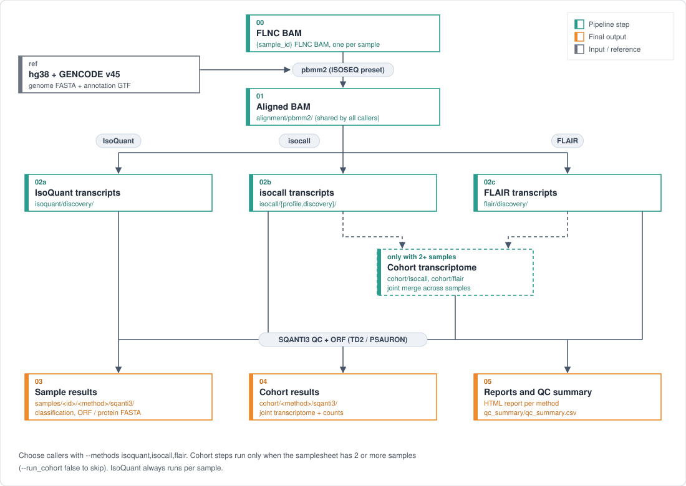

# PBLONGREADRNA — K-MAP PacBio long-read RNA (Iso-Seq) pipeline

A Nextflow (DSL2) + Singularity pipeline that takes one PacBio full-length non-concatemer (FLNC) BAM per sample, aligns it once with pbmm2, discovers transcripts with IsoQuant, isocall and FLAIR, and runs SQANTI3 structural QC, ORF prediction (TD2 / PSAURON) and an HTML report for every result. With two or more samples, isocall and FLAIR also build a joint cohort transcriptome. Reference: hg38 + GENCODE v45.

<p align="center"></p>

## How it works

```
FLNC BAM (one BAM per sample; CCS, demultiplexing and FLNC preparation are upstream)
  │
  ├─ 01 PBMM2 (ISOSEQ)   alignment to hg38, once per sample, shared by all callers
  │                      * skipped with start_step=discovery (existing aligned BAM)
  ├─ 02 discovery        IsoQuant  /  isocall profile → call  /  FLAIR transcriptome
  │     └─ cohort        isocall merge + call, FLAIR combine   * only with 2+ samples
  ├─ 03 SQANTI3          structural QC of every transcript set
  ├─ 04 ORF              TD2 / PSAURON, transcript and protein FASTA
  └─ 05 report           HTML report per result + QC summary for all samples
```

No FASTQ/FASTA conversion or extra read alignment is done; transcript and protein FASTA are kept as outputs.

### Choosing callers

`--methods` takes any comma-separated subset of `isoquant,isocall,flair` (default: all three). Unselected callers are not launched; the shared pbmm2 alignment still runs once per sample.

| Request | Options |
|---|---|
| All three, independent samples | `--analysis_mode single` |
| IsoQuant only | `--methods isoquant --analysis_mode single` |
| isocall only, joint calling | `--methods isocall --analysis_mode multi` |
| FLAIR only, independent samples | `--methods flair --analysis_mode single` |
| isocall + FLAIR, joint calling | `--methods isocall,flair --analysis_mode multi` |
| All three, sample + cohort outputs | `--analysis_mode both` |

### Single-sample and multi-sample modes

`--analysis_mode` sets the scope of isocall / FLAIR. IsoQuant is always per sample.

| Mode | Per-sample calls and SQANTI3 | Cohort calls and SQANTI3 |
|---|---|---|
| `auto` (default) | yes | yes when there are 2+ samples and `--run_cohort true` |
| `single` | yes, for every row in the CSV | no |
| `multi` | no final per-sample SQANTI3 | yes; needs 2+ samples |
| `both` | yes | yes; needs 2+ samples |

- In `multi`, FLAIR still builds each sample transcriptome before `combine`, and isocall builds each sample profile before the joint call; these intermediate outputs are published. Cohort count outputs keep one column per sample.
- To run a single sample, give a one-row CSV. Explicit modes override `--run_cohort`.
- Use a separate `--outdir` for each mode so files from another mode are not mistaken for current outputs.

## Requirements

| Item | Location | Notes |
|---|---|---|
| Java 17+ | system, or **installed automatically** by `setup.sh` | Nextflow 26.04.3 is pinned and downloaded by `setup.sh` |
| Singularity / Apptainer, Python 3 | system | |
| `containers/kmap_isoseq_main.sif` | [GitHub Release `isoseq-v1.0.0`](https://github.com/Junil-lab/KMAP/releases/tag/isoseq-v1.0.0) | pbmm2 26.1.99, samtools, IsoQuant 3.13.1, QC scripts |
| `containers/kmap_isoseq_discovery.sif` | GitHub Release `isoseq-v1.0.0` | isocall 1.3.0, FLAIR 3.0.0 (pinned commit + patch), minimap2, samtools |
| `containers/sqanti3_v6.0.1.sif` | official SQANTI3 image, **fetched by `setup.sh`** | SQANTI3 6.0.1 (pinned digest), TD2 / PSAURON, R reporting |
| `resources/ref/hg38.fa` (+ `.fai`), `gencode.v45.annotation.gtf` | user supplied (see [Reference](#reference)) | optional: polyA motifs, polyA atlas BED, CAGE peaks |

### Containers

```bash
bash setup.sh --download-containers --release-tag isoseq-v1.0.0   # main + discovery from the release, SQANTI3 from its official image
```

- `bash setup.sh` alone fetches SQANTI3 if missing and checks everything; `--no-download-sqanti3` checks local files only; `--assets-dir /path` uses already downloaded release assets.
- To build the KMAP images yourself: `bash def/build_containers.sh` (or `bash def/build_containers.sh discovery --rebuild`). A rebuild backs up the previous image.
- FLAIR's upstream commit and the local patch for empty / no-SQ SAM streams are in `def/kmap_isoseq_discovery.def` and `def/patches/`.
- Exact sources, asset names and offline installation: [docs/container_releases.md](docs/container_releases.md).

### Reference

Put the files in `resources/ref/` (local files or symlinks; see [resources/ref/README.md](resources/ref/README.md)):

- `hg38.fa` and `hg38.fa.fai` (`samtools faidx hg38.fa`), `gencode.v45.annotation.gtf` — genome and GTF must use the same contig names.
- Optional: `polyA_motifs.human.txt`, `atlas.clusters.2.0.GRCh38.96.chr.bed`, `hg38_fair+new_CAGE_peaks_phase1and2.bed`. Missing optional files are skipped; disable one with e.g. `--cage_peak_bed false`.
- Other locations: `--genome_fa`, `--gencode_gtf` or a `-c` config. An explicitly set path that does not exist stops the run.

## Running

### 1. Check the environment (once)

```bash
git clone https://github.com/Junil-lab/KMAP.git
cd KMAP/PBLONGREADRNA

# references in resources/ref/ (see Reference above), then
bash setup.sh --download-containers --release-tag isoseq-v1.0.0   # installs Java 17 / Nextflow if needed, fetches containers, checks everything
```

### 2. Write a samplesheet

Copy `input/samples.example.csv` and fill it in.

```csv
sample_id,flnc_bam,tissue,start_step,aligned_bam
SampleA,/data/SampleA/flnc.bam,lung,pbmm2,
SampleB,,kidney,discovery,/data/SampleB/SampleB.aligned.bam
```

| Column | Value |
|---|---|
| `sample_id` | unique; letters, digits, `_`, `-`, `.`; starts with a letter or digit |
| `flnc_bam` | FLNC BAM (needed for `start_step=pbmm2`); relative paths are resolved from the CSV's folder |
| `tissue` | free text; empty becomes `NA` |
| `start_step` | optional. `pbmm2` — from the FLNC BAM (default)<br>`discovery` — skip pbmm2 and start IsoQuant / isocall / FLAIR from `aligned_bam` |
| `aligned_bam` | for `start_step=discovery`: a coordinate-sorted BAM aligned to the same hg38 (e.g. `alignment/pbmm2/<id>.aligned.bam` of an earlier run) with its `.bai` next to it |

The two optional columns can be left out; a three-column CSV (`sample_id,flnc_bam,tissue`) runs everything from pbmm2. Rows with different `start_step` values can be mixed in one CSV, and cohort analysis still uses all samples. To continue a run that stopped later (e.g. in SQANTI3), use `-resume`.

Standard CSV quoting, UTF-8 BOM and Windows line endings are accepted.

### 3. Run

```bash
bash run.sh --samplesheet input/samples.csv --threads 16 --check-only   # validate inputs and containers only
bash run.sh --samplesheet input/samples.csv --threads 16 --outdir /path/to/results

# common options
#   -resume                      continue from where it stopped (reuses the cache)
#   --methods isoquant,isocall,flair   callers to run (see Choosing callers)
#   --analysis_mode auto|single|multi|both
#   --run_cohort false           no cohort analysis in auto mode
#   -profile slurm -c cluster.config   SLURM (default queue: cpu)
#   export NXF_WORK=/fast/local/disk/work   # intermediate files (default: <pipeline folder>/.nf_work)
```

`--threads` is the CPU request per task, not a limit for the whole run. To cap total use, set `executor.cpus`, `executor.memory` or `process.maxForks` in a local config (`-c`). On a shared server, also limit the cores: `taskset -c 0-4 bash run.sh ... --threads 5`.

### Disk use and clean-up

Nextflow keeps every intermediate file in the work directory (`.nf_work/` or `$NXF_WORK`), and results are published to `--outdir`. `-resume` needs that work directory and the `.nextflow/` cache of the original launch folder. After checking the results, free the space with `./nextflow clean -f` or by removing the work directory (after which `-resume` no longer works).

## Outputs

```
<outdir>/samples/<sample_id>/
├── alignment/pbmm2/                     shared alignment for all three callers
├── isoquant/{discovery,sqanti3}/
├── isocall/{profile,discovery,sqanti3}/
└── flair/{discovery,sqanti3}/
<outdir>/cohort/                         only with 2+ samples
├── isocall/{discovery,sqanti3}/
└── flair/{discovery,sqanti3}/
<outdir>/reference/isocall/known_isoforms.gz
<outdir>/qc_summary/                     per-method CSVs and qc_summary.csv
<outdir>/pipeline_info/                  trace, timeline, report, run logs
```

### What each folder contains

| Folder | File | Values |
|---|---|---|
| `alignment/pbmm2` | aligned BAM + flagstat | FLNC reads aligned to hg38 (ISOSEQ preset) |
| `alignment/input` | flagstat | `start_step=discovery` only: statistics of the aligned BAM you supplied (the BAM itself is not copied) |
| `isoquant/discovery` | `*.transcript_models.gtf` | known + novel transcript models |
| | `*.discovered_transcript_counts.tsv`, `*.discovered_transcript_tpm.tsv` | counts / TPM for the models above (`*.transcript_counts.tsv` / `*.transcript_tpm.tsv` are reference transcripts only) |
| `isocall/{profile,discovery}` | per-sample profile, transcript GTF, count matrix | isocall's native counts |
| `flair/discovery` | transcriptome GTF / FASTA, `*.isoform.counts.txt` | FLAIR `transcriptome` read counts (no separate `quantify` realignment) |
| `cohort/{isocall,flair}` | joint transcriptome + count matrix | one column per sample |
| `*/sqanti3` | classification table, ORF / protein FASTA, HTML report | SQANTI3 structural categories (FSM, ISM, NIC, NNC, …), TD2 / PSAURON ORFs |
| `qc_summary/qc_summary.csv` | | one row per sample × method and per cohort result: scope, sample, method, tissue, alignment totals / rate, SQANTI3 categories |
| `pipeline_info/` | | run time and memory per step |

## Notes

- **Counts between callers** are not interchangeable: IsoQuant, isocall and FLAIR each report their own native counts.
- **Mapping rate** counts mapped alignment records (QC-passed and QC-failed); it is not a deduplicated molecule count. Cohort alignment counts sum the participating samples.
- **Failures**: core tasks retry twice, then stop the run; QC errors stop immediately. The final QC requires every expected sample × method row and every enabled cohort row. A protein FASTA may be absent when no coding isoforms are predicted; HTML reports are always required.
- **Reference data** are not distributed with the code; record their source URLs and checksums for each study.

## Validation

```bash
python3 -m unittest discover -s tests -p 'test_*.py' -v
bash tests/run_smoke.sh
bash tests/run_selection_matrix.sh test_runs/smoke
bash tests/run_single_example.sh test_runs/smoke
```

`start_step=discovery` was checked on the smoke data (2026-10-30): starting both samples from their aligned BAMs, and mixing one aligned BAM with one FLNC BAM, both gave a QC summary identical to the full run from pbmm2.

The smoke test builds a synthetic 100 kb reference and two samples with 408 FLNC reads each, and runs all three callers, cohort analysis, SQANTI3 / ORF / HTML, optional polyA / CAGE annotations and the sample-complete QC. The selection matrix checks all seven caller subsets in `single` mode, each cohort-capable caller in `multi`, and `multi` / `both` together. These are functional tests on synthetic reads, not biological accuracy or human-scale runtime tests.

Runtime of one full sample:

```bash
python3 benchmarks/run_sample.py --samplesheet input/samples.csv \
    --sample <sample_id> --threads 16 --outdir test_runs/full_sample_run
```

It runs all three callers without `-resume`, one task at a time, and writes timings to `benchmark_results.json` (input / alignment, discovery, SQANTI3 / ORF / report, and total wall time).

Validation reports: [docs/validation.md](docs/validation.md), [official SQANTI3 image](docs/official_sqanti3_validation_20261026.md).
