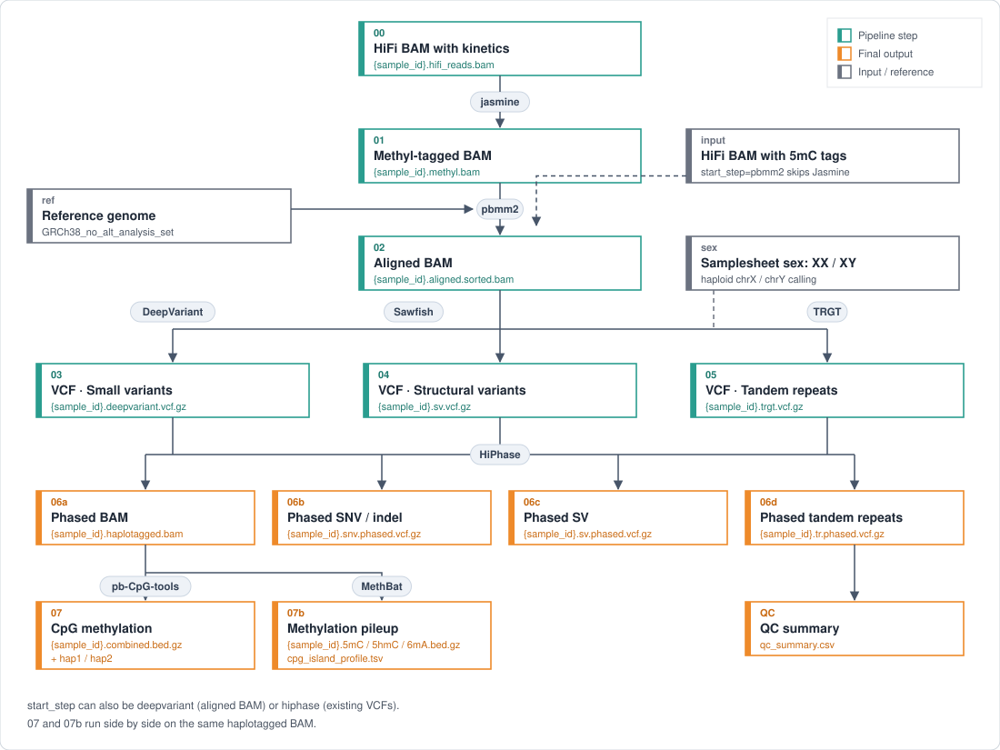

# PBLONGREADWGS — K-MAP PacBio HiFi WGS pipeline

A Nextflow (DSL2) + Singularity pipeline that takes one PacBio HiFi BAM per sample and runs alignment → SNV/indel → SV → tandem repeats → phasing → CpG methylation in one go. Reference: GRCh38 (`GRCh38_no_alt_analysis_set`).

<p align="center"></p>

## How it works

```
HiFi BAM (one BAM per sample, whole genome)
  │
  ├─ 01 JASMINE      kinetics (ip/pw) → 5mC tags (MM/ML)   * only when start_step=jasmine
  ├─ 02 PBMM2        alignment to GRCh38
  ├─ 03 DEEPVARIANT  SNV/indel (GPU)
  ├─ 04 SAWFISH      structural variants (SV)
  ├─ 05 TRGT         tandem repeat genotyping (adotto + STRchive catalog)
  ├─ 06 HIPHASE      joint SNV + SV + TR phasing, haplotagged BAM
  ├─ 07 CPG_TOOLS    CpG methylation, pb-CpG-tools model mode (combined / hap1 / hap2)
  └─ 07b METHBAT     CpG methylation, MethBat pileup (5mC / 5hmC / 6mA) + CpG island profile
                     (same haplotagged BAM as 07, runs in parallel; --run_methbat false to skip)
       └─ QC summary (per sample + all samples)
```

### Sex handling

The `sex` value (XX/XY) in the samplesheet is passed to three tools. It is **required**; the run stops before starting if it is empty or anything else.

| Tool | XX | XY |
|---|---|---|
| DeepVariant | default (diploid) | `--haploid_contigs chrX,chrY` + PAR BED (PARs stay diploid) |
| Sawfish | `expected_cn.hg38.XX.bed` | `expected_cn.hg38.XY.bed` + `--treat-single-copy-as-haploid` |
| TRGT | `--karyotype XX` | `--karyotype XY` (chrX PAR is also treated as haploid — TRGT's own behaviour) |

For cell lines whose karyotype differs from the donor's sex (e.g. a line that lost one X), set the value **from the data** (one X copy, no Y → XY).

## Requirements

| Item | Location | Notes |
|---|---|---|
| Java 17+ | system, or **installed automatically** by `setup.sh` | Nextflow 26 needs Java 17+. If missing, `setup.sh` downloads OpenJDK 17 into `.java17/` and `run.sh` uses it |
| Singularity / Apptainer | system | |
| GPU (optional) | – | for DeepVariant; without one use `--use_gpu false` |
| `containers/kmap_pbwgs_v2.sif` | [GitHub Release v1.0.0](https://github.com/Junil-lab/KMAP/releases/tag/v1.0.0) | pbmm2, jasmine, sawfish, trgt, hiphase, pb-CpG-tools, samtools/bcftools — can be built with `def/build_containers.sh` |
| `containers/deepvariant_1.9.0-gpu.sif` | Docker Hub | `google/deepvariant:1.9.0-gpu` |
| `containers/methbat_1.1.0.sif` | bioconda (quay.io) | `quay.io/biocontainers/methbat:1.1.0--h9ee0642_0` (7 MB) |
| `resources/ref/GRCh38_no_alt_analysis_set.fna` (+ `.fai`, `.mmi`) | NCBI (see [Reference genome](#reference-genome)) | ~3.1 GB + 5.8 GB `.mmi` |
| `resources/ref/trgt/adotto_strchive_20250827.hg38.noFailTag.bed.gz` | **in this repo** | catalog from the PacBio HiFi-human-WGS-WDL v4.0.0 reference bundle (Zenodo) with the `;INCLUDE_FAIL_READS` tag removed (same processing as the WDL) |
| `resources/ref/methbat/cpgIslandExt.sorted.hg38.tsv` | **in this repo** | CpG islands for `methbat profile`, from the MethBat repository `data/` folder |
| `resources/ref/sex/*.bed` | **in this repo** | PAR BED, Sawfish expected copy number BEDs |

The GRCh38 reference and BAMs are not in the repo because of their size (`.gitignore`).

### Reference genome

Download GRCh38 (no-alt analysis set) from NCBI and build the index files with the main container (run after downloading the containers):

```bash
cd PBLONGREADWGS/resources/ref
wget -O - https://ftp.ncbi.nlm.nih.gov/genomes/all/GCA/000/001/405/GCA_000001405.15_GRCh38/seqs_for_alignment_pipelines.ucsc_ids/GCA_000001405.15_GRCh38_no_alt_analysis_set.fna.gz \
  | gunzip > GRCh38_no_alt_analysis_set.fna
singularity exec ../../containers/kmap_pbwgs_v2.sif samtools faidx GRCh38_no_alt_analysis_set.fna
singularity exec ../../containers/kmap_pbwgs_v2.sif pbmm2 index GRCh38_no_alt_analysis_set.fna GRCh38_no_alt_analysis_set.fna.mmi   # takes tens of minutes
```

On the K-MAP lab server the files already exist; link them instead of downloading:

```bash
ln -s /home/NAS_2/K_MAP/PacBio_WGS_pipeline_v2/resources/ref/GRCh38_no_alt_analysis_set.fna* PBLONGREADWGS/resources/ref/
```

Symlinked references are fine: `run.sh` finds the real location of every link in `resources/ref/` and binds it into the containers. If the links point to a slow network disk, the first read of the 5.8 GB `.mmi` by pbmm2 can take a long time; a copy on a local disk is faster.

## Running

### 1. Check the environment (once)

```bash
git clone https://github.com/Junil-lab/KMAP.git
cd KMAP/PBLONGREADWGS

# containers
wget -O containers/kmap_pbwgs_v2.sif \
  https://github.com/Junil-lab/KMAP/releases/download/v1.0.0/kmap_pbwgs_v1.0.0.sif
singularity pull containers/deepvariant_1.9.0-gpu.sif docker://google/deepvariant:1.9.0-gpu
singularity pull containers/methbat_1.1.0.sif docker://quay.io/biocontainers/methbat:1.1.0--h9ee0642_0

# GRCh38 reference (+ .fai, .mmi) goes in resources/ref/ (see Reference genome above)
bash setup.sh          # installs Java 17 if needed; checks Singularity / nextflow / SIFs / references; all [OK] means ready
```

### 2. Write a samplesheet

Copy `input/samples.csv` and fill it in.

```csv
sample_id,bam,sex,start_step
SampleA,/absolute/path/SampleA.hifi_reads.bam,XX,pbmm2
SampleB,/absolute/path/SampleB.hifi_reads.bam,XY,pbmm2
```

| Column | Value |
|---|---|
| `sample_id` | name of the output folder |
| `bam` | absolute path. Must be **inside the pipeline folder** → if it is elsewhere, `ln -s /external/path/x.bam input/bam/` |
| `sex` | `XX` or `XY` (required) |
| `start_step` | `jasmine` — BAM with kinetics (ip/pw) but no methylation tags<br>`pbmm2` — HiFi BAM that already has methylation tags (MM/ML) (most cases)<br>`deepvariant` / `hiphase` — restart from the middle |

#### Jasmine or not? Check the BAM tags first

Whether a sample needs `start_step=jasmine` depends on the tags in its BAM:

| Tags in the BAM | Meaning | `start_step` |
|---|---|---|
| `MM` + `ML` on every read | 5mC already called (Jasmine or Primrose ran on the instrument / in SMRT Link) | `pbmm2` |
| kinetics only (`fi`/`ri`/`fp`/`rp`, or `ip`/`pw`) | raw kinetics kept, 5mC not called yet | `jasmine` |
| neither | no methylation information | `pbmm2` (CpG output will be empty) |

Run from the pipeline folder (samtools is in the main container):

```bash
SIF=containers/kmap_pbwgs_v2.sif
BAM=input/bam/sample.hifi_reads.bam

# 1. programs that produced this BAM — jasmine or primrose means 5mC was already called
singularity exec -B $PWD $SIF samtools view -H $BAM | grep '^@PG' | grep -oE 'ID:[^[:space:]]+' | sort -u

# 2. count the tags on the first 1,000 reads and suggest a start_step
singularity exec -B $PWD $SIF samtools view $BAM 2>/dev/null | head -n 1000 | awk '
{ mm = ml = kin = 0
  for (i = 12; i <= NF; i++) { t = substr($i, 1, 2)
    if (t == "MM" || t == "Mm") mm = 1
    if (t == "ML" || t == "Ml") ml = 1
    if (t ~ /^(fi|ri|fp|rp|ip|pw)$/) kin = 1 }
  n++; MM += mm; ML += ml; K += kin }
END { printf "reads: %d | MM: %d  ML: %d  kinetics: %d\n", n, MM, ML, K
  if (MM == n && ML == n) print "=> start_step=pbmm2   (5mC tags present, Jasmine not needed)"
  else if (K > 0)         print "=> start_step=jasmine (kinetics present, no 5mC tags)"
  else                    print "=> no 5mC tags and no kinetics: methylation cannot be called" }'

# 3. what the tags look like (MM: C+m = 5mC positions, ML: probability of each, 0-255)
singularity exec -B $PWD $SIF samtools view $BAM 2>/dev/null | head -1 | tr '\t' '\n' | grep -E '^(MM|ML)' | cut -c1-60
```

Output for the HG002 example BAM:

```
ID:ccs ID:pbmm2 ID:primrose ID:samtools ...
reads: 1000 | MM: 1000  ML: 1000  kinetics: 0
=> start_step=pbmm2   (5mC tags present, Jasmine not needed)
ML:B:C,202,230,117,167,16,144,247,0,0,1,221,2,176,253,255,54
MM:Z:C+m?,63,30,2,80,34,146,4,45,0,113,69,36,7,73,0,3,25,64,
```

After a run with `start_step=jasmine`, confirm that Jasmine worked by running the same commands on `<outdir>/<sample_id>/01_methyl_bam/<sample_id>.methyl.bam`: `@PG` should now list `jasmine`, and every read should have `MM`/`ML`. The Jasmine log is `01_methyl_bam/<sample_id>.jasmine.log`.

### 3. Run

```bash
bash run.sh --samplesheet input/my_samples.csv --outdir /path/to/results --threads 16

# common options
#   -resume              continue from where it stopped (reuses the cache)
#   --use_gpu false      DeepVariant without GPU (the GPU image also runs on CPU, just slower)
#   --dv_sif <path>      use another DeepVariant image, e.g. a CPU build or another version
#                        (needs --haploid_contigs support, DeepVariant >= 1.6)
#   --vcf_dir <dir>      existing VCF location when start_step=hiphase
#   export NXF_WORK=/fast/local/disk/work   # move intermediate files (default: <pipeline folder>/.nf_work)
```

On a shared server, limit the cores: `taskset -c 0-4 bash run.sh ... --threads 5`

### Disk use and clean-up

Nextflow keeps every intermediate file in the work directory (`.nf_work/` or `$NXF_WORK`) and never deletes it, and outputs are **copied** from there to `--outdir`, so BAMs exist twice. In the HG002 test (2.2 GB input) the work directory was 6.6 GB and the outputs 5.4 GB; plan for several times the input BAM size per sample.

After checking the results, free the space:

```bash
./nextflow clean -f        # or: rm -rf .nf_work   (after this, -resume no longer works)
```

Memory: the largest step is DeepVariant (~31 GB peak in the test; up to 64 GB is reserved per task). Memory is released when each task ends, but running several samples at once adds up.

## Outputs

```
<outdir>/<sample_id>/
├── 01_methyl_bam/        (only if the jasmine step ran)
├── 02_aligned_bam/
├── 03_small_variants/
├── 04_structural_var/
├── 05_tandem_repeats/
├── 06a_phased_bam/
├── 06b_phased_SNP/
├── 06c_phased_SV/
├── 06d_phased_TR/
├── 07_CpG_methylation/
├── 07b_MethBat/
└── logs/
<outdir>/qc_summary/      QC table for all samples
<outdir>/pipeline_info/   timeline / report / trace, run logs
```

### What each folder contains

| Folder | File | Values |
|---|---|---|
| `02_aligned_bam` | `*.aligned.sorted.bam` (+ `.bai`) | reads aligned to GRCh38; methylation tags (MM/ML) are kept |
| | `*.flagstat.txt` | read counts: total, primary, supplementary, mapped |
| `03_small_variants` | `*.deepvariant.vcf.gz` | SNVs/indels. `GT` genotype, `GQ` genotype quality, `DP` depth, `AD` reads per allele, `VAF` variant allele fraction. Only `FILTER=PASS` records are variants; `RefCall` records are not |
| | `*.deepvariant.g.vcf.gz` | gVCF (also non-variant blocks), for joint calling across samples |
| `04_structural_var` | `*.sv.vcf.gz` | SVs ≥ 50 bp (DEL/INS/DUP/INV/BND) and CNVs. `SVTYPE`, `SVLEN`, `END`, `GT`; CNVs also `CN` (copy number) |
| | `*.sv.run.stats.json` | Sawfish run statistics (candidates, output record count) |
| `05_tandem_repeats` | `*.trgt.vcf.gz` | genotypes at ~937k repeat loci. `MOTIFS` repeat unit, `AL` allele lengths, `MC` motif counts, `SD` supporting reads, `AM` methylation in the repeat |
| | `*.trgt.spanning.sorted.bam` | reads spanning each repeat (for plots/IGV) |
| `06a_phased_bam` | `*.haplotagged.bam` | reads tagged with `HP` (haplotype 1/2) and `PS` (phase block) |
| | `*.summary.tsv` | phasing per chromosome: heterozygous / phased variants, number of blocks, block NG50 |
| | `*.blocks.tsv` | phase blocks (chrom, start, end, variant count) |
| | `*.stats.csv` | detailed per-block statistics |
| `06b_phased_SNP` | `*.snv.phased.vcf.gz` | PASS SNVs/indels from 03 with phase: `GT` like `0\|1`, plus `PS` |
| `06c_phased_SV` | `*.sv.phased.vcf.gz` | SVs from 04 with phase |
| `06d_phased_TR` | `*.tr.phased.vcf.gz` | tandem repeats from 05 with phase |
| `07_CpG_methylation` | `*.combined.bed.gz` | per-CpG methylation: position, `mod_score` (% methylated, 0–100), `cov` (depth), estimated methylated / unmethylated read counts |
| | `*.hap1.bed.gz`, `*.hap2.bed.gz` | the same per haplotype (allele-specific methylation) |
| `07b_MethBat` | `*.5mC.bed.gz` | MethBat pileup per CpG; `type` column `Total` / `hap1` / `hap2` in one file. `mod_score` (% methylated), `cov`, `mod_count` / `unmod_count` (read counts, not model estimates) |
| | `*.5hmC.bed.gz`, `*.6mA.bed.gz` | the same for 5hmC and 6mA (stranded); empty unless the BAM has those tags |
| | `*.cpg_island_profile.tsv` | one row per CpG island: `summary_label` (`Methylated` / `Unmethylated` / `AlleleSpecificMethylation` / `NoData`), mean hap1 / hap2 / combined methylation, ASM Fisher p-value, phased site counts, coverage |
| | `*.summary.json` | MethBat run settings and per-modification summary |
| `qc_summary.csv` | | one row per sample: mapping rate, reads, SV count, phased variants, phase blocks, maximum chromosome NG50 |
| `pipeline_info/` | | run time and memory per step (`trace.csv`, `timeline.html`, `report.html`) |

## Notes

- **Runtime**: HG002 chr20+X+Y (~5% of the genome) on 5 cores took 3 h 16 min, 76% of it DeepVariant. Give a whole-genome 30x run plenty of cores.
- **pb-CpG-tools vs MethBat**: both run on the same haplotagged BAM. pb-CpG-tools 3.0.0 (model mode, reference CpGs) is kept as the main CpG output because it agreed better with bisulfite data in our comparison; MethBat 1.1.0 (the tool PacBio is moving to; pb-CpG-tools will be deprecated) is added for 5hmC/6mA, CpG island profiles and future MethBat analyses. MethBat reports CpGs found in the reads, so a small fraction of its sites are not CG in the reference. MethBat runs with its default settings, as its developers recommend.
- **Methylation**: the pipeline summarises the methylation tags already in the BAM. 5hmC/6mA are only available if the tags were produced at sequencing time and the kinetics were kept.
- **Check TRGT logs**: TRGT exits 0 even if some loci fail. Check the `[ERROR]` lines in the `05_tandem_repeats` task log.
- **Removed steps**: variant annotation (VEP, AnnotSV) and sTELLeR (TE detection) were removed in this version.
- **Reference point**: the tool set mostly matches PacBio's official [HiFi-human-WGS-WDL](https://github.com/PacificBiosciences/HiFi-human-WGS-WDL) v4.0.0; versions here are DeepVariant 1.9.0 / TRGT 5.0.0 / HiPhase 1.6.0 / Sawfish 2.2.1 / pb-CpG-tools 3.0.0.

## Validation

### HG002 example

[example/HG002_chr20XY/](example/HG002_chr20XY/) is a small test on HG002 (XY, chr20 + chrX + chrY, ~3 h on 5 cores): a script that downloads the input BAM from PacBio's public data, step-by-step commands to run it, the expected numbers to compare your results with, and the reference outputs (except BAMs). Run it once after installing, before real samples.

### QC checks (2026-10-24)

QC is generated for every supported start step, including `deepvariant` and `hiphase`.
Alignment statistics are recomputed from the BAM supplied to phasing; QC-passed and
QC-failed alignment records are both included. These are alignment-record counts,
not deduplicated molecule counts. `total_sv` counts all records in the input SV VCF
(before HiPhase PASS filtering), including CNVs and non-PASS records.

QC collection waits for CpG output and rejects malformed statistics. QC merging
requires exactly one successful row for every unique samplesheet ID. Duplicate IDs
and unsupported start steps are rejected. Invalid QC terminates the run.

`max_chromosome_block_ng50` replaces the misleading `block_n50` column. Its value
is the maximum of the chromosome-level NG50 values reported by HiPhase, not a
whole-sample N50 or NG50. Historical example outputs retain their original schema.

Tests: `python3 -m unittest discover -s tests -p 'test_*.py' -v`.
`python3 tests/run_qc_routing.py --nextflow /path/to/nextflow --out /new/test/directory`
checks all four entry routes with stubbed biological tools and real QC aggregation.
This is a routing regression test, not a new end-to-end variant-calling benchmark.
