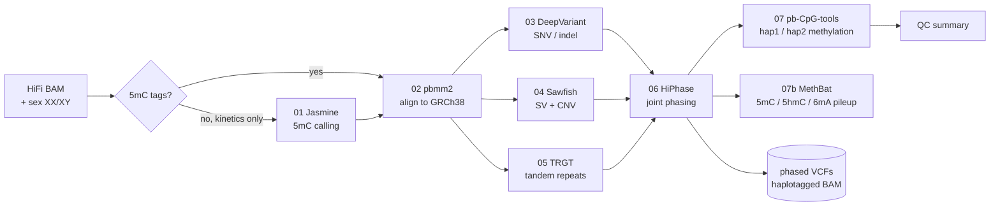

<h1 align="center">KMAP Pipeline</h1>

<p align="center">
  Reproducible Nextflow + Singularity pipelines for the K-MAP multi-omics project<br>
  PacBio HiFi whole-genome · PacBio long-read RNA · single-cell RNA-seq
</p>

<p align="center">
  <a href="https://github.com/Junil-lab/KMAP/releases"></a>
  
  
  
  
</p>

---

## Pipelines

| Module | Data | What it does | Status |
|---|---|---|---|
| [**PBLONGREADWGS**](PBLONGREADWGS/) | PacBio HiFi WGS (BAM) | alignment → SNV/indel → SV → tandem repeats → joint phasing → CpG methylation, sex-aware on chrX/chrY | ✅ **v1.0.0** — tested on HG002 |
| [**PBLONGREADRNA**](PBLONGREADRNA/) | PacBio Iso-Seq / Kinnex | pbmm2 → IsoQuant / isocall / FLAIR → SQANTI3 + ORF; sample/cohort modes | available — see module validation report |
| [**SCRNA**](SCRNA/scRNAseq_QC_pipeline/) | 10x Genomics scRNA-seq (FASTQ) | Cell Ranger → CellBender → QC → SOLO doublet removal | ⚠️ available — QC container not distributed yet |

Every module follows the same pattern: **one samplesheet in, one command to run, all tools inside Singularity containers**, so results do not depend on what is installed on the server.

### What is ready in each module

✅ ready · ⚠️ works with extra steps or limits · ❌ not available yet

| | PBLONGREADWGS | SCRNA | PBLONGREADRNA |
|---|---|---|---|
| **Input** | HiFi BAM | 10x FASTQ, raw H5 or CellBender H5 | FLNC BAM |
| **Start from the middle** | `start_step`: jasmine / pbmm2 / deepvariant / hiphase | `start_step`: cellranger / cellbender / qc | – (choose callers with `--methods`) |
| **Main container** | ✅ GitHub Release `v1.0.0` (`kmap_pbwgs_v1.0.0.sif`) | ❌ `scrnaseq_qc.sif` is not distributed, and `def/scrnaseq_qc.def` copies a conda environment from the lab server, so it cannot be built elsewhere yet | ✅ GitHub Release `isoseq-v1.0.0` (main + discovery) |
| **Other containers** | ✅ DeepVariant (Docker Hub) and MethBat (quay.io) are pulled with one command | ⚠️ Cell Ranger: build from your own 10x download (license)<br>✅ CellBender pulled from its public image (tag `latest`, version not pinned) | ✅ official SQANTI3 image fetched by `setup.sh` |
| **Reference** | GRCh38 from NCBI (+ index); TRGT catalog, sex BEDs and CpG islands are in the repo | 10x `refdata-gex` download | hg38 + GENCODE v45 (see `resources/ref/`) |
| **Java 17 / Nextflow** | ✅ installed by `setup.sh` | ⚠️ Java 17 must already be installed | ✅ installed by `setup.sh` |
| **Lab-server paths in the code** | ✅ none | ⚠️ conda environment and Java paths of the lab server (`nextflow.config`, `run.sh`, `def/`) | ✅ none |
| **Tested** | ✅ full HG002 chr20/X/Y run with expected numbers; fresh-clone run; MethBat step on a small test BAM | ⚠️ unit tests + stubbed routing test here; real-data runs only on the lab server | ⚠️ synthetic-read functional tests + 12-sample isocall merge; a full human sample was not rerun for the release |
| **Example data** | ✅ HG002 chr20/X/Y (download script + expected outputs) | ❌ | ❌ |

---

## PBLONGREADWGS at a glance



| Step | Tool | Version |
|---|---|---|
| 5mC from kinetics | Jasmine | 2.7.99 |
| Alignment | pbmm2 | 26.1.99 |
| Small variants | DeepVariant | 1.9.0 (GPU) |
| Structural variants | Sawfish | 2.2.1 |
| Tandem repeats | TRGT (adotto + STRchive catalog, 937k loci) | 5.0.0 |
| Phasing | HiPhase | 1.6.0 |
| CpG methylation | pb-CpG-tools | 3.0.0 |
| Methylation pileup + CpG island profile | MethBat | 1.1.0 |
| Utilities | samtools / bcftools | 1.23.1 |

**Sex-aware calling** — the samplesheet `sex` column switches DeepVariant haploid calling, Sawfish expected copy number and TRGT karyotype together. On HG002 (XY): 0 heterozygous DeepVariant calls on chrX outside the PARs, and haploid TRGT and Sawfish genotypes on chrX/chrY.

The tool set mirrors PacBio's official [HiFi-human-WGS-WDL](https://github.com/PacificBiosciences/HiFi-human-WGS-WDL) v4.0.0.

---

## Quick start (WGS)

```bash
git clone https://github.com/Junil-lab/KMAP.git
cd KMAP/PBLONGREADWGS

# containers
wget -O containers/kmap_pbwgs_v2.sif \
  https://github.com/Junil-lab/KMAP/releases/download/v1.0.0/kmap_pbwgs_v1.0.0.sif
singularity pull containers/deepvariant_1.9.0-gpu.sif docker://google/deepvariant:1.9.0-gpu
singularity pull containers/methbat_1.1.0.sif docker://quay.io/biocontainers/methbat:1.1.0--h9ee0642_0

# reference: see PBLONGREADWGS/README.md → Reference genome
bash setup.sh            # installs Java 17 if needed, checks everything

bash run.sh --samplesheet input/samples.csv --outdir results --threads 16
```

```csv
sample_id,bam,sex,start_step
SampleA,/abs/path/SampleA.hifi_reads.bam,XX,pbmm2
```

New here? Run the **[HG002 example](PBLONGREADWGS/example/HG002_chr20XY/)** first (~3 h on 5 cores) and compare your numbers with the reference results.

---

## Repository layout

```
KMAP/
├── PBLONGREADWGS/          PacBio HiFi WGS pipeline
│   ├── main.nf, nextflow.config, run.sh, setup.sh
│   ├── def/                container recipes
│   ├── resources/ref/      sex BEDs + TRGT catalog (GRCh38 FASTA downloaded separately)
│   └── example/HG002_chr20XY/   test input script, expected outputs
├── PBLONGREADRNA/          PacBio long-read RNA pipeline
└── SCRNA/
    └── scRNAseq_QC_pipeline/   10x scRNA-seq preprocessing and QC
```

## Documentation

- [PBLONGREADWGS/README.md](PBLONGREADWGS/README.md) — requirements, samplesheet, options, every output file explained
- [PBLONGREADWGS/example/HG002_chr20XY/](PBLONGREADWGS/example/HG002_chr20XY/) — step-by-step test run with expected results
- [PBLONGREADRNA/README.md](PBLONGREADRNA/README.md) — tool selection, sample/cohort modes, SQANTI3 and ORF outputs
- [SCRNA/scRNAseq_QC_pipeline/README.md](SCRNA/scRNAseq_QC_pipeline/README.md) — scRNA-seq workflow and QC defaults
- [Releases](https://github.com/Junil-lab/KMAP/releases) — prebuilt containers

